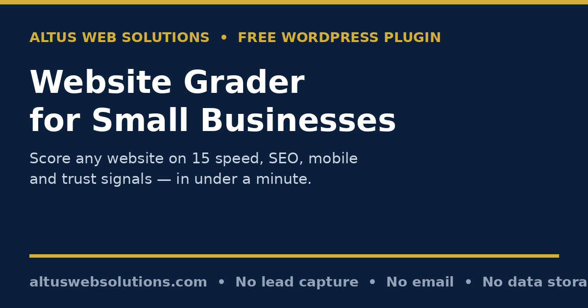

# Altus Website Grader — Free WordPress Website Grader Plugin

**A free website grader for small businesses: enter any website address and get a score out of 100, a grade from A to F, and the full 15-point report — speed, SEO, mobile and trust — in under a minute, shown on screen.**

> **⬇️ Download now:** get the latest release zip from the [**Releases page**](../../releases) → WordPress → Plugins → Add New → Upload Plugin → Install Now → Activate → add the shortcode `[altus_website_grader]` to any page.

**Keywords people search for:** free website grader, website grader WordPress plugin, website health check plugin, small business website audit, free SEO checker WordPress, website speed test plugin, check my website score, WordPress website grader, homepage SEO audit, website trust check.

## What it does

Most small-business owners have no idea whether their website is helping or quietly losing them customers. A slow homepage, a missing page title, or a "Not secure" warning can send a visitor straight to a competitor before they read a single word — and the owner never hears about it.

Altus Website Grader answers that question in under a minute. A visitor types in a website address, and the plugin measures the site's real public homepage and grades it on 15 signals across four areas. There is no account, no signup, and — in this open-source version — no email gate: the score, the top 3 issues and the complete 15-point report are all shown on screen, free.

## Who it is for

- **Small-business owners** who want a plain-English answer to "is my website any good?" without hiring an agency first.
- **Freelancers, web designers and agencies** who want a quick first-pass audit to show a prospect exactly what needs fixing.
- **WordPress site owners** who want a homepage health check they can run on their own site any time, for free.

## The problem it solves

Professional audits are expensive and full of jargon; free online graders usually demand an email address before showing the real findings, or they invent a vague score with no explanation. This plugin does neither. Every one of the 15 checks produces a measured detail string — a real response time in seconds, a real title length in characters, a real certificate expiry in days — so the score is something you can act on, not just admire.

## Features — and why each one matters

### Speed checks (3)

- **Server response time** — measured as real TTFB (time to first byte) via cURL. Why it matters: a slow server makes every page feel slow, hurts Google rankings, and is the first thing visitors notice. Results are graded against clear thresholds (under 1 second is good; over 2.5 seconds needs work).
- **Homepage size** — the actual size of the homepage HTML. Why it matters: a heavy homepage loads slowly on mobile connections, and most small-business visitors are on phones.
- **Compression enabled** — checks for gzip, Brotli, deflate or zstd encoding. Why it matters: compression shrinks every page transfer and is usually a one-line server or plugin setting — a quick win most sites miss.

### Trust & security checks (3)

- **Secure HTTPS connection** — whether the site actually loads over HTTPS. Why it matters: browsers flag non-HTTPS sites as "Not secure", which scares visitors and hurts rankings.
- **SSL certificate validity** — reads the real certificate expiry and reports days remaining. Why it matters: an expired certificate produces a full-page browser warning. Implausibly long expiries (for example from an intercepting proxy) are honestly reported as unverifiable, not claimed as real.
- **HSTS security header** — checks for the Strict-Transport-Security header. Why it matters: once HTTPS is in place, HSTS is a small hardening win that forces browsers to always use the secure connection.

### SEO basics checks (6)

- **Page title** — length and presence of the `<title>` tag. Why it matters: the title is what Google shows in search results; 30–60 characters displays fully.
- **Meta description** — length and presence. Why it matters: the description controls the snippet Google shows — without one, you don't control the pitch.
- **Single H1 heading** — exactly one H1 is good. Why it matters: one clear main heading helps Google and screen readers understand the page.
- **Image alt text** — how many homepage images have descriptive alt text. Why it matters: alt text helps image search and accessibility; missing alt text is one of the most common easy fixes.
- **Language attribute** — whether the `<html>` tag carries a `lang` attribute. Why it matters: it helps search engines and screen readers, and costs nothing to add.
- **Social sharing (Open Graph) tags** — `og:title` and `og:image`. Why it matters: without them, shares of your site on Facebook, LinkedIn and WhatsApp look plain or broken.

### Mobile & findability checks (3)

- **Mobile-friendly viewport** — the viewport meta tag. Why it matters: without it, a site looks tiny or broken on phones, where most visitors browse.
- **Favicon** — detected from the page or from `/favicon.ico`. Why it matters: a favicon makes your brand recognisable in browser tabs and bookmarks.
- **Robots.txt + sitemap** — checks for a robots.txt with a sitemap reference (including the common WordPress sitemap locations). Why it matters: a robots.txt with a sitemap helps Google discover and index every page.

Every check is reported as **Good**, **Could improve**, or **Needs work** — and "Could improve" honestly means "worth attention, not necessarily broken".

## How it works

1. Add the shortcode `[altus_website_grader]` to a page.
2. A visitor enters a website address (business name optional) and clicks **Grade my website**.
3. The plugin fetches only the site's **public homepage** (plus its robots.txt, sitemap and favicon, where relevant) — no login, no private data, no access to anything behind a password.
4. It scores the 15 checks (good = 1, could improve = 0.5, needs work = 0), converts that to a percentage and a grade: A (85%+), B (70%+), C (55%+), D (40%+), F (below 40%).
5. The visitor sees the score, the grade, a plain-English summary ("11 passed, 4 need attention") and the top 3 issues to fix.
6. One click on **Show my full report** reveals all 15 checks with a measured detail and a plain-English explanation of what to do about each one — on screen, immediately.

The check is rate-limited to 5 checks per IP address per hour, so one visitor cannot hammer other people's websites through your site.

## Installation (2 minutes, from the release zip)

1. Download the latest `altus-website-grader-v1.0.0.zip` from the [**Releases page**](../../releases).
2. In WordPress, go to **Plugins → Add New → Upload Plugin**, choose the zip, click **Install Now**, then **Activate**.
3. Create or edit a page and add the shortcode: `[altus_website_grader]`
4. Publish the page. Done — visitors can grade any public website from it.

Requires WordPress 5.8+ and PHP 7.4+. No settings page, no API key, no account.

## Frequently asked questions

**Is the Website Grader really free?**
Yes. The score, the top 3 issues and the full 15-point report are all free, with no account and no email address required in this open-source version.

**What does the grader check?**
15 signals across four areas: speed (server response time, page size, compression), trust (HTTPS, SSL certificate validity, HSTS), SEO (title, meta description, H1, image alt text, language attribute, Open Graph tags) and mobile/findability (viewport, favicon, robots.txt + sitemap).

**Do you store my website data?**
No. This GitHub version contains NO lead capture, NO email sending, and NO data storage — results are shown on screen only. The version hosted on altuswebsolutions.com may offer email delivery; this open-source version does not. The only server-side state is a short-lived rate-limit counter (5 checks per IP per hour); no result, URL, business name or personal data is saved.

**Does it fetch anything private?**
No. It fetches only the public homepage and the public robots.txt / sitemap / favicon of the address entered — the same pages anyone can see in a browser. It never accesses logins or private data. Private, reserved, loopback and link-local addresses are blocked, including after redirects, so it cannot be used to probe internal networks.

**Is this the same as Google PageSpeed Insights?**
No. PageSpeed is a deeper lab audit of scripts, images and real-user experience. This grader is a fast homepage health check: the fundamentals every small-business site should get right first. It says so on the report itself.

**My score is low. What now?**
The report tells you exactly what to fix, in plain English. Many fixes are quick — a meta description here, a favicon there, compression switched on. If a check says "could not be measured", check it manually with PageSpeed Insights rather than assuming the worst.

**Can I use it on client sites?**
Yes — that is one of its main uses. Run it on a prospect's site and the report itself becomes the conversation about what to fix.

## Honest limits

- It grades the **homepage only**, not every page of a site.
- It is an **automated homepage check, not a full PageSpeed/Lighthouse audit** — it does not measure images, scripts or real-user experience in depth.
- If a site blocks automated checks, the grader will honestly say it could not load the site, rather than invent a score.
- Some checks (for example certificate expiry and response time) can be unavailable depending on the server; those are reported as "could not be measured", not guessed.
- A high score does not guarantee Google rankings, and a low score does not mean a site is "broken" — it means specific fundamentals need attention.

## Changelog

### 1.0.0
- First public release (stripped open-source version of the Altus Website Grader).
- 15 homepage checks across speed, SEO, mobile and trust, with score (0–100%) and grade (A–F).
- Full 15-point report shown on screen; top 3 issues highlighted first.
- Email gate, lead storage and email sending removed: no lead table, no visitor email, no owner notification.
- SSRF guard hardened: private/reserved addresses blocked before fetching and re-checked after redirects; rate limit of 5 checks per IP per hour retained.
- Version taken from the original plugin header (1.0.0); no version number invented for this release.

## Data handling — read this before installing

- **What it does:** fetches the public homepage (and public robots.txt / sitemap / favicon) of the URL a visitor types in, grades it, and shows the result on screen.
- **What it does NOT do:** it stores nothing (no database table, no saved files containing user input), sends no email (no report to the visitor, no notification to the site owner), uploads nothing to the server, and transmits no user-supplied personal data anywhere except the single public-URL fetch described above, whose content is graded and discarded, never saved.
- **Rate limiting:** a transient counter (keyed by a hash of the visitor's IP) limits checks to 5 per IP per hour. That counter holds a number only — no URL, name, email or result.

## Disclaimer

This software is provided free of charge, "as is", WITHOUT warranty of any kind, express or implied, including but not limited to the warranties of merchantability, fitness for a particular purpose and non-infringement. The authors and contributors are NOT liable for any loss, damage or cost arising from the use of this software, including any decisions made from a grading report. This tool gives an automated homepage health check, not professional SEO, security or legal advice. Back up your site first and test on staging where possible before installing any plugin on a live site.

## Licence

GPLv2 or later — see [LICENSE](LICENSE). You are free to use, modify and redistribute this plugin under the terms of the GNU General Public License, version 2 or any later version.

---

Built by [Altus Web Solutions](https://altuswebsolutions.com) — the version on altuswebsolutions.com may offer email delivery of the full report; this open-source version does not, by design.
